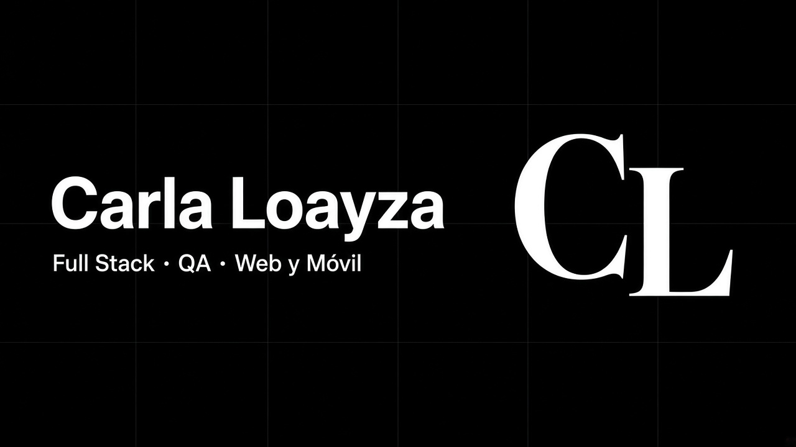

<!-- Perfil inspirado en widgets actuales: typing-svg, skillicons, github-readme-stats, trophies, streak, activity-graph -->

  

  

  
  
  
  

---

### Sobre mí

Full Stack & QA from Bolivia. Construyo apps web y móviles, integro sistemas y cuido la calidad antes de producción.  

---

### Tech Stack

  

---

### Destacados

| Proyecto | Descripción |
|---|---|
| **SOS Prevención Segura** | App de prevención · 1er lugar CURSOR × YAIS |
| **KoquiFI Lottery** | Producto Web3 lanzado en equipo |
| **ARQUISOFT / NASA Space Apps** | Pagos digitales y sostenibilidad urbana |
| **Conecta** | App móvil con impacto social |

---

### GitHub Stats

  
  

  

  

  

---

### Contribution Snake

  <picture>
    <source media="(prefers-color-scheme: dark)" srcset="https://raw.githubusercontent.com/TheDuckHacker/TheDuckHacker/output/github-contribution-grid-snake-dark.svg" />
    <source media="(prefers-color-scheme: light)" srcset="https://raw.githubusercontent.com/TheDuckHacker/TheDuckHacker/output/github-contribution-grid-snake.svg" />
    
  </picture>

---

### Let's connect

  
  
  

  <em>Abierta a nuevas oportunidades y colaboraciones</em>

